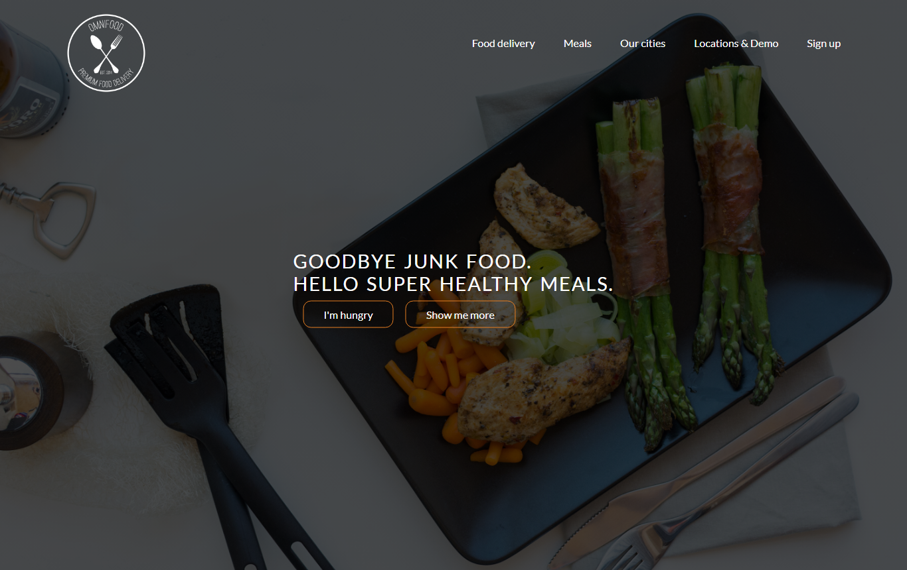

# Waly Foods

> A responsive landing page for a healthy-food delivery service, built with HTML, CSS and Bootstrap.




## Sections

- **Hero** with call-to-action buttons.
- **Features:** "Get food fast, not fast food".
- **Meals:** a photo gallery.
- **Cities:** delivery locations.
- **Testimonials** from customers.
- **Sign up:** pricing plans.
- **Maps & Videos**.

It is fully responsive (mobile, tablet and desktop) and uses icon fonts and web fonts.

## Run it

Open `index.html` in a browser, or serve the folder:

```bash
python -m http.server 8000
```

## Credits

The design is based on the well-known "Omnifood" landing-page project, rebuilt here as front-end practice.

## Author

**Ahmed Gamal Saber**, Full-Stack Web Developer & AI Engineer
[LinkedIn](https://linkedin.com/in/ahmed-gamal-saber-382081169) · [GitHub](https://github.com/AhmedGamal98)
